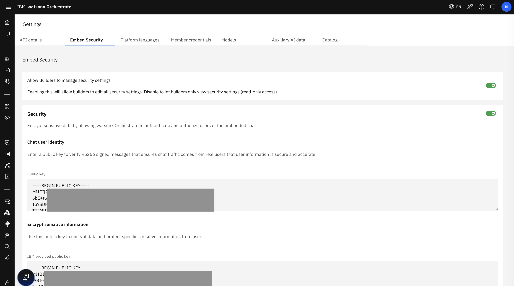
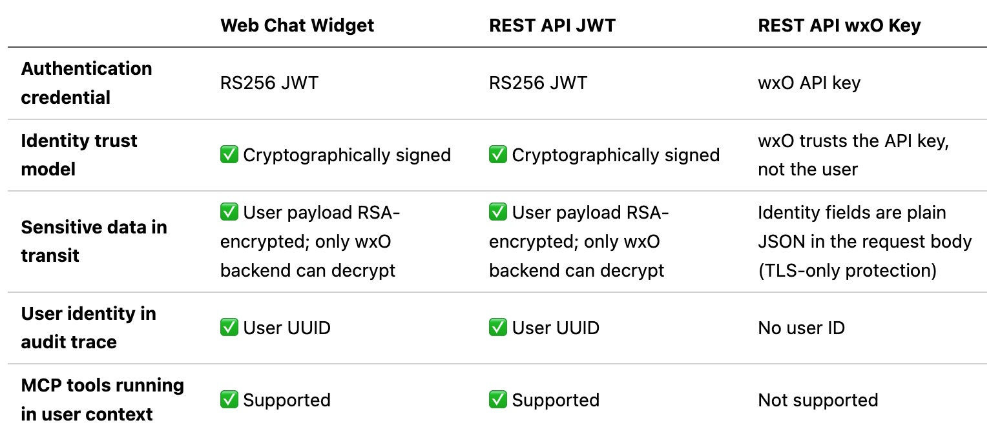

*In enterprise applications, AI agents frequently access downstream systems on behalf of users. Custom applications that embed IBM watsonx Orchestrate agents handle user authentication, passing the user identity to Orchestrate and subsequently to enterprise systems. This post describes how to achieve this using the watsonx Orchestrate REST API.*

My previous post [Connecting Custom Apps to Orchestrate via REST APIs]({{ "/article/orchestrate-surface-rest-api/" | relative_url }}) explored the option of authenticating via a watsonx Orchestrate (wxO) API key. While this approach is adequate for automated background jobs running on shared credentials, it does not securely propagate the user identity.

## Asymmetric JWT Authentication

To integrate watsonx Orchestrate into your existing applications and execute agents and tools on behalf of users, you can embed the Orchestrate Web Chat widget. The widget leverages asymmetric JSON Web Token (JWT) authentication utilizing client private and public keys.

To enable this security feature, you must create an RS256 public/private key pair and configure it within Orchestrate.



## wxO API Key vs JWT

This same authentication mechanism can also be applied to the REST API. Consequently, there are multiple alternatives for embedding Orchestrate agents in custom applications, each with distinct characteristics:

1. Web Chat widget (with security enabled)
2. REST API JWT
3. REST API wxO API key



**Best Practices:**

- Use a wxO API Key for server-to-server integrations or automated background jobs where no human user is involved.
- Use a Client JWT when your application acts on behalf of an authenticated user in custom user interfaces or mobile applications.

## Implementation

The following resources describe this feature in greater detail:

* [Client JWT Authentication](https://developer.ibm.com/apis/catalog/watsonorchestrate--custom-assistants/Client+JWT+Authentication+for+Direct+API+Access+in+watsonx+Orchestrate)
* [Enabling security](https://www.ibm.com/docs/en/watsonx/watson-orchestrate/base?topic=chat-enabling-web-security)
* [Using the chat APIs](https://developer.watson-orchestrate.ibm.com/webchat/get_started#using-the-chat-apis)
* [/v1/orchestrate/runs?stream=true](https://developer.watson-orchestrate.ibm.com/apis/orchestrate-agent/chat-with-orchestrate-assistant) endpoint

## JWT Structure

The following [snippet](https://developer.watson-orchestrate.ibm.com/webchat/get_started#example-implementation) illustrates the structure of the JWT token:

```javascript
const PRIVATE_KEY = fs.readFileSync(config.CLIENT_PRIVATE_KEY_PATH);
const IBM_PUBLIC_KEY = fs.readFileSync(config.IBM_PUBLIC_KEY_PATH);

/**
 * Encrypt an object with IBM's public key so only wxO can decrypt it.
 *
 * @param {object} payload - Plain object to encrypt.
 * @returns {string} Base64-encoded ciphertext.
 */
function encryptUserPayload(payload) {
    const data = Buffer.from(JSON.stringify(payload), 'utf-8');
    return ibmRsaKey.encrypt(data, 'base64');
}

/**
 * Create a signed RS256 JWT.
 *
 * JWT structure:
 *   {
 *     sub:          string          — stable user identifier
 *     user_payload: string          — RSA-encrypted base64 blob (only wxO can read)
 *     context:      object          — plain key/value pairs readable by the agent
 *   }
 *
 * @param {string} sub          - Stable, unique user identifier.
 * @param {object} [context={}] - Key/value pairs the agent can read (NOT encrypted).
 * @param {object} [userPayload={}] - Sensitive fields to encrypt.
 * @returns {string} Signed JWT string.
 */
function createJwtString(sub, context = {}, userPayload = {}) {
    const claims = {
        sub,
        context,
        user_payload: encryptUserPayload(userPayload),
    };

    return jwt.sign(claims, PRIVATE_KEY, {
        algorithm: 'RS256',
        expiresIn: '1h',
    });
}
```

## REST Endpoint

The next snippets show how to invoke the [/v1/orchestrate/runs?stream=true](https://developer.watson-orchestrate.ibm.com/apis/orchestrate-agent/chat-with-orchestrate-assistant) endpoint with the JWT token.

```javascript
router.post('/', async (req, res) => {
    // ── 1. Auth gate ──────────────────────────────────────────────────────────
    if (!req.session?.user || !req.session?.access_token) {
        return res.status(401).json({ error: 'Not authenticated' });
    }
    ...
    
    // ── 2. Build JWT from the authenticated session user ──────────────────────
    const { sub, name, email } = req.session.user;
    const roles       = req.session.roles        || [];
    const accessToken = req.session.access_token;

    const jwtContext = {
        clientID:  'trip-booking-app',
        email,
        user_id:   sub,
        sub:       sub,
        sso_token: accessToken,
        roles,
    };

    const jwtUserPayload = {
        name,
        custom_user_id: sub,
    };

    let jwtToken;
    try {
        jwtToken = createJwtString(sub, jwtContext, jwtUserPayload);
    } catch (err) {
        return res.status(500).json({ error: 'Failed to create JWT', detail: err.message });
    }

    // ── 3. Build the wxO runs payload ─────────────────────────────────────────
    const runsPayload = {
        message: {
            role:                 'user',
            content:              message.trim(),
            additional_properties: {},
        },
        context:  jwtContext,
        agent_id: config.WXO_AGENT_ID,
    };
    if (config.WXO_AGENT_ENV_ID) {
        runsPayload.environment_id = config.WXO_AGENT_ENV_ID;
    }
    if (thread_id) {
        runsPayload.thread_id = thread_id;
    }

    // ── 4. Query params ────────────────
    const queryParams = {
        stream:         'true',
        stream_timeout: String(DEFAULT_STREAM_TIMEOUT),
    };

    try {
        await callWxoStream(
            '/orchestrate/runs',
            'POST',
            runsPayload,
            res,
            jwtToken,
            queryParams,
        );
    } catch (err) {
        ...
    }
});

...

/**
 * Make a streaming request to the wxO backend and pipe the response body
 * directly into an Express response object.
 *
 * The widget sends newline-delimited JSON (not standard SSE `data:` lines).
 * Each line is a complete SSEEvent: { id, event, data: { thread_id, run_id, delta?, ... } }
 *
 * @param {string} path       - Path relative to /v1, e.g. '/orchestrate/runs'.
 * @param {string} method     - HTTP method (always 'POST' for runs).
 * @param {object} body       - Run request payload.
 * @param {object} expressRes - Express response object to stream into.
 * @param {string} [jwtToken] - Pre-minted JWT. A fresh one is generated if omitted.
 * @param {object} [queryParams] - Extra query-string params (e.g. { stream: 'true', stream_timeout: '60000' }).
 */
async function callWxoStream(path, method, body, expressRes, jwtToken, queryParams = {}) {
    let token = jwtToken || freshJwt();
    let retried = false;

    const attempt = async () => {
        const qs = new URLSearchParams(queryParams).toString();
        const url = buildUrl(path) + (qs ? `?${qs}` : '');
        const headers = getAuthHeaders(token);

        const response = await fetch(url, {
            method,
            headers,
            body: JSON.stringify(body),
        });

        if (response.status === 401 && !retried) {
            // Refresh JWT and retry once.
            retried = true;
            token = freshJwt();
            return attempt();
        }

        if (!response.ok) {
            ...
        }

        // Stream the wxO response body straight through to the Express caller.
        // Content-Type: text/plain — the body is newline-delimited JSON, not standard SSE.
        expressRes.setHeader('Content-Type', 'text/plain; charset=utf-8');
        expressRes.setHeader('Transfer-Encoding', 'chunked');
        expressRes.setHeader('Cache-Control', 'no-cache');
        expressRes.setHeader('X-Accel-Buffering', 'no');
        const { Readable } = require('stream');
        const nodeStream = response.body.pipe
            ? response.body
            : Readable.fromWeb(response.body);
        nodeStream.pipe(expressRes);

        nodeStream.on('error', (err) => {
            ...
        });
    };

    return attempt();
}
```

## Next Steps

To find out more, check out the following resources:

* [Agent Identity in IBM watsonx Orchestrate]({{ "/article/orchestrate-agent-identity/" | relative_url }})
* [User Identity in watsonx Orchestrate]({{ "/article/agent-user-identity-mcp/" | relative_url }})
* [Building secure Orchestrate Agents with HashiCorp Vault]({{ "/article/watsonx-orchestrate-hashicorp-vault/" | relative_url }})
* [Authenticating Types]({{ "/article/watsonx-orchestrate-authentication-types/" | relative_url }})
* [Watsonx Orchestrate Developer](https://developer.watson-orchestrate.ibm.com)
* [Watsonx Orchestration Documentation](https://www.ibm.com/docs/en/watsonx/watson-orchestrate/base)